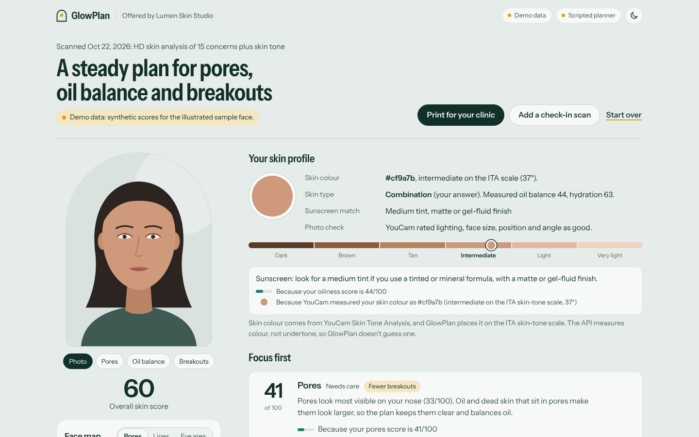
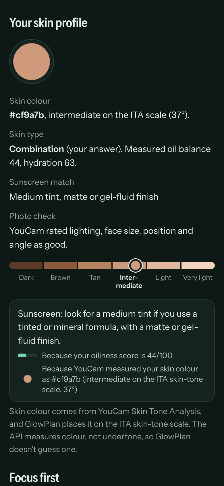
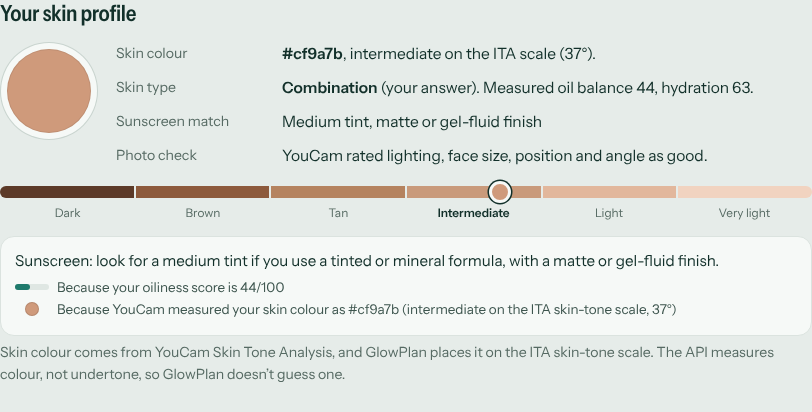
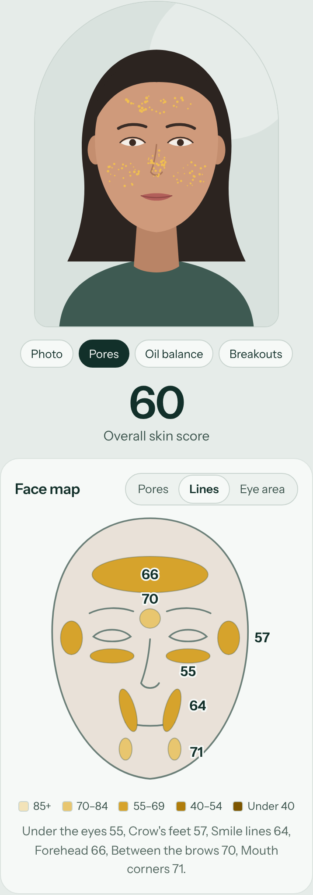
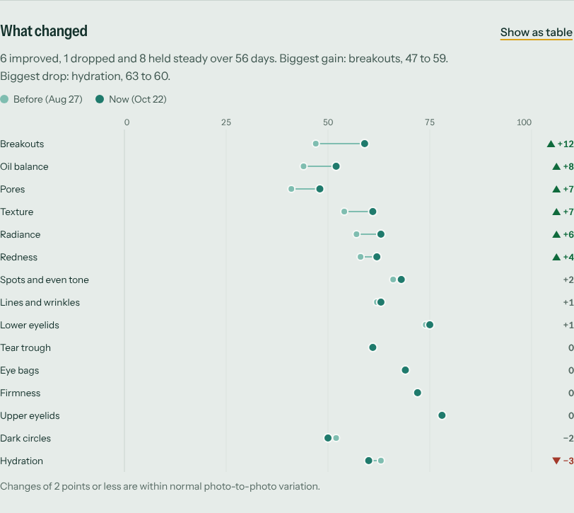
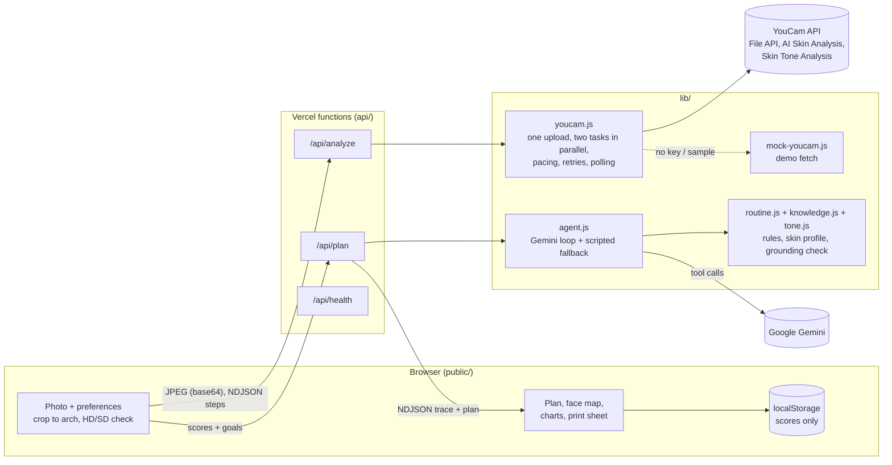

# GlowPlan

**Scan your skin. Get a routine you can follow.**

GlowPlan is a skin-care planning agent built on two YouCam APIs (Perfect Corp): **AI Skin Analysis** and **Skin Tone Analysis**. One selfie, uploaded once, gives 15 measured skin scores and a measured skin colour. GlowPlan turns them into a morning and evening routine that fits the person's goals, budget and time, matches the sunscreen to their skin, explains when a clinic visit could help, tracks change between scans, and prints a one-page summary to bring to a consultation.

It works for one person on their phone, and for an aesthetic clinic that wants to offer it to clients: add `?clinic=Your%20Clinic` to the URL and the app and the printed summary carry the clinic's name.

Built for the [YouCam API Skin AI & eCommerce VTO Hackathon](https://youcam-api-skin-ai-ecommerce.devpost.com/), **Skin AI** track.

**Live demo: [glowplan.vercel.app](https://glowplan.vercel.app)**



| Phone, dark | Skin profile (Skin Tone Analysis) | Face map with YouCam overlays | Progress between scans |
| --- | --- | --- | --- |
|  |  |  |  |

> Cosmetic guidance, not medical advice. GlowPlan does not diagnose and never claims a product or treatment will work for someone.

---

## Why

A skin-analysis score on its own leaves people asking "so what do I do?". Most routines online are generic, and most people buy too many products at once, layer things that shouldn't be layered, and can't tell after two months whether anything changed. Clinics see the other side of this: clients arrive with no record of what they tried.

GlowPlan closes that loop: **measure, plan, re-measure**, and keep every recommendation traceable to a number the person can see.

## What it does

1. **Photo in, safely.** Take a selfie (`capture="user"` opens the front camera on phones) or upload one. Drag and zoom it into the arch so the face fills the oval (YouCam needs the face to be over 60% of the image width). GlowPlan checks the resolution live and tells you whether it qualifies for an **HD scan** (short side 1080 px or more, with per-region scores) or a **standard scan** (480 px or more).
2. **Two YouCam analyses, one upload.** The server uploads the photo once through the YouCam File API, then starts an **AI Skin Analysis** task (all 15 scored concerns) and a **Skin Tone Analysis** task on the same `file_id`, in parallel, and polls both. The screen shows each step live, ending with "Skin analysis ✓" and "Skin tone ✓". Skin tone is optional: if it fails (for example a tilted head), the skin scan still goes ahead and the plan says skin tone wasn't measured.
3. **Your skin profile.** The measured skin colour (`skin_color`) is shown as a swatch and placed on the ITA (Individual Typology Angle) skin-tone scale, which GlowPlan computes from the colour with standard CIELAB maths. Next to it: the stated skin type with the measured oil balance and hydration, a sunscreen match (tint family from skin tone, finish from oil and hydration), and YouCam's photo check (lighting, face size, position, angle). The API measures colour, not undertone, so GlowPlan never guesses one.
4. **An agent builds the plan.** A Gemini tool-calling agent (or the same tools run by a scripted planner when no Gemini key is set):
   - ranks the 15 scores against the person's goals and reads the skin profile,
   - picks three focus areas and explains each in plain language,
   - chooses ingredient classes (niacinamide, salicylic acid, retinoid, SPF 30+ and so on, never brands) that fit the budget, time per day, skin type, sensitivity and pregnancy,
   - builds morning and evening routines that respect layering rules (no two exfoliants or retinoids on the same night, retinoids only at night, sunscreen every morning),
   - uses the measured skin tone where it matters: a tinted mineral sunscreen with iron oxides in a light, medium or deep tint (iron oxides also filter visible light, which can deepen spots), gentle tone-evening ingredients for medium-to-deep skin with breakouts or spots (marks after irritation can last months), and a caution to ask about laser, IPL and peel settings on medium-to-deep skin,
   - adds a "start slowly" schedule that introduces one product at a time,
   - lists in-clinic treatment categories that clinics commonly offer for concerns that score low, described neutrally, plus "see someone promptly" safety flags.
5. **Every recommendation cites a measured value.** Each focus area, routine step, profile note and professional suggestion carries a citation like *"because your pores score is 41/100"* or *"because YouCam measured your skin colour as #cf9a7b (intermediate on the ITA skin-tone scale, 37°)"*. The server attaches these from the scan; the model never writes the numbers. A grounding check rejects any plan where a citation is missing or doesn't match the scan, and drops model text that mentions a score that isn't in the scan.
6. **Face map and YouCam overlays.** HD scans return pores per region (forehead, nose, cheeks) and lines per region (forehead, between the brows, crow's feet, under the eyes, smile lines, mouth corners). GlowPlan draws them on a face map, and shows YouCam's mask overlay image for each focus concern ("where the scan saw it").
7. **Progress.** Run a check-in scan later (it reuses the measured skin tone, so it costs only the skin analysis), or upload an older "before" photo with today's. A dumbbell chart shows before and after for every concern, sorted by change, with a table view. Moves of 2 points or less are marked as normal photo-to-photo variation.
8. **Clinic-ready summary.** "Print for your clinic" produces a one-page A4 summary (save as PDF from the print dialog): all scores with regions, the measured skin colour, focus areas, the current routine with the sunscreen match, change since last scan, discussion points, questions to ask, and a box for clinician notes. No photo is printed. A sample is in [`docs/clinic-summary-sample.pdf`](docs/clinic-summary-sample.pdf).

## How YouCam is used

All calls go from the server (the API key never reaches the browser). Implemented in [`lib/youcam.js`](lib/youcam.js) against the official docs at <https://docs.perfectcorp.com> (Quick Start, API Server, Rate Limit, AI Skin Analysis v2.0/v2.1 reference) and Perfect Corp's official [`YouCam-API/skills`](https://github.com/YouCam-API/skills) repository.

| Step | Call | Status |
| --- | --- | --- |
| Auth | `Authorization: Bearer <YOUCAM_API_KEY>` (one key from the API console; no client secret or token exchange) | Documented |
| Server | `https://yce-api-01.makeupar.com` | Documented |
| 1. Register file | `POST /s2s/v2.0/file` with `{files:[{content_type, file_name, file_size}]}` → `data.files[0].file_id` and `requests[0]` (`PUT` URL + headers) | Documented |
| 2. Upload | `PUT` the bytes to the signed URL with the returned headers | Documented |
| 3. Start task | `POST /s2s/v2.1/task/skin-analysis` with `{src_file_id, dst_actions[15], miniserver_args:{enable_mask_overlay:true}, format:"json"}` → `data.task_id` | Documented (v2.1 path from the official skills repo; v2.0 via `YOUCAM_SKIN_VERSION=v2.0`) |
| 4. Poll | `GET /s2s/v2.1/task/skin-analysis/{task_id}` → `data.task_status` `running` / `success` / `error` | Documented |
| Result | `data.results.output[]`: `{type, region, ui_score, raw_score, score, mask_urls}`; errors as `data.error` (for example `error_src_face_too_small`) | Field names documented; see notes |
| 3b. Skin tone | `POST /s2s/v2.0/task/skin-tone-analysis` with `{src_file_id, face_angle_strictness_level:"medium"}`, on the **same `file_id`**, in parallel with step 3 | Documented (AI Facial Color Tones Analyzer, doc v1.0; path from the docs and the official repo) |
| 4b. Poll tone | `GET /s2s/v2.0/task/skin-tone-analysis/{task_id}` → `data.results.color` `{skin_color, eye_color, eye_color_name, lip_color, eyebrow_color, hair_color, hair_color_name}` and `data.results.face_quality` `{has_face, area, frontal, lighting, faceangle}` | Field names documented |
| Balance check | `GET /s2s/v1.0/client/credit`, `GET /s2s/v2.0/credit/feature-cost` (only in `npm run youcam:check`) | From the official skills repo |

**Concerns requested.** HD: `hd_wrinkle, hd_pore, hd_texture, hd_acne, hd_redness, hd_oiliness, hd_moisture, hd_radiance, hd_firmness, hd_age_spot, hd_dark_circle, hd_eye_bag, hd_tear_trough, hd_droopy_upper_eyelid, hd_droopy_lower_eyelid`. SD uses the same names without `hd_` (and `dark_circle_v2`). HD and SD are never mixed in one request (the API rejects that). `skin_type` is left out on purpose: the person states their skin type, and 15 concerns cost the same as 16.

**Scores.** `ui_score` is 1 to 100 and higher means healthier-looking skin (less of that concern). GlowPlan shows `ui_score` and keeps `raw_score` internally, as the official skill recommends.

**Units per scan.** Documented costs: Skin Analysis SD 9 / 12 / 14 / 16 and HD 12 / 16 / 20 / 22 units for 1-4 / 5-8 / 9-12 / 13-16 concerns; Skin Tone Analysis 20 units. Units are charged only when a task succeeds.

| Scan | Skin Analysis (15 concerns) | Skin Tone | Total |
| --- | --- | --- | --- |
| First scan, HD | 22 | 20 | **42** |
| Check-in scan, HD (tone reused) | 22 | 0 | **22** |
| First scan, SD | 16 | 20 | **36** |
| Check-in scan, SD | 16 | 0 | **16** |
| Bundled sample | 0 | 0 | **0** |

Skin colour doesn't change with a skin-care routine, so GlowPlan measures it once and reuses it on check-ins (`SKIN_TONE_MODE=first`, the default). A person's first scan plus two check-ins costs 86 units, about 29 per scan. A target of about 35 units for every scan is not possible with a full 15-concern HD analysis plus skin tone (22 + 20 = 42), so the first scan costs more on purpose. Set `SKIN_TONE_MODE=every` to measure tone on every scan (42 HD), or `off` to keep every scan at 22. The hackathon's 1,000 free units cover about 23 first scans or 45 check-ins.

**Face Attribute Analysis was considered and left out.** Face shape costs 10 units (1-5 features) and its uses are makeup and hairstyle advice. Nothing in a skin-care routine depends on it, so adding it would cost units without making the plan better.

**Reliability.** Calls are paced (220 ms minimum gap, under the recommended ~5 requests/second; the documented limit is 250 requests per 300 s per IP and per key). `429` and `5xx` responses on safe calls are retried with exponential backoff and `Retry-After`. Creating a task is retried only on `429`/`503` (an explicit refusal), so a slow response can never create a second billable task. If YouCam is still working after ~19 s, the API returns the task id and the browser keeps polling `GET /api/analyze?task_id=…`, so Vercel's 30 s function limit is never the bottleneck.

**Image rules enforced before spending units.** JPG/PNG only, under 3.3 MB after the browser re-encodes it (YouCam allows 10 MB; Vercel's request limit is 4.5 MB), short side at least 480 px, HD from 1080 px. The server reads the dimensions (including EXIF rotation) from the file header. YouCam's own errors (face too small, too dark, no face, more than one person, and Skin Tone's face-angle errors such as "tilt your head up slightly") come back as plain retake tips.

**What is not verified yet.** No live key was used while building, so the client was built to the documentation and tested against a mock that reproduces the documented shapes and validation rules. Three details are handled defensively because the docs show them only partly. (0) The docs don't say outright that one uploaded `file_id` can feed two different tasks (the official skills upload once per run). GlowPlan reuses it; if the tone task gets a `404`, it uploads once more for that task only. Then two details of the skin-analysis result: (1) where the overall score and skin age appear in a `format=json` result (the parser accepts a per-item `score`, `type: "all"` / `"skin_age"` items, or the `score_info.json` shape from `format=zip`, and falls back to the average of the 15 scores, labelled as such); (2) how regional HD results are listed (the parser expects one `output` item per `region`, as in the v2.1 schema, and also accepts nested regions). Run `npm run youcam:check -- your-selfie.jpg` with a key to see the live result in the terminal.

## Architecture



- **Front end**: plain HTML, CSS and ES modules, no build step. Charts and the face map are inline SVG drawn with DOM APIs.
- **API**: three Vercel Node functions sharing [`lib/http.js`](lib/http.js); [`dev-server.js`](dev-server.js) runs the same handlers locally with zero dependencies.
- **Agent** ([`lib/agent.js`](lib/agent.js)): tools `rank_concerns`, `skin_profile`, `find_ingredients`, `professional_options`, `draft_routine`, `finalize_plan`. Gemini decides which to call and writes the plain-language notes; the deterministic engine in [`lib/routine.js`](lib/routine.js) enforces budget, time, layering and safety rules and attaches citations. If Gemini is missing, slow or fails, the scripted policy runs the same tools and finishes the plan.
- **Knowledge** ([`lib/knowledge.js`](lib/knowledge.js)): a small, conservative map from each concern to ingredient classes (with typical over-the-counter strengths, irritation level, timing, pregnancy flags) and to in-clinic treatment categories with consultation thresholds. HD regions make the professional suggestions specific: low crow's feet scores point to expression-line treatments, low smile-line scores to volume treatments.
- **Skin tone** ([`lib/tone.js`](lib/tone.js)): parses the Skin Tone result, converts `skin_color` to CIELAB and computes the ITA° (bands from Chardon et al. 1991 and Del Bino et al. 2006: very light, light, intermediate, tan, brown, dark). The ITA comes from one photo's colour, so the UI calls it an estimate and lighting caveats apply. The server always re-derives it from the hex, never trusting a value sent by the browser.

## Privacy

- Photos are read into memory, sent once to YouCam (both analyses use that one upload), and dropped. GlowPlan never writes them to disk, never logs request bodies, and never stores them in the browser.
- YouCam keeps uploaded files for 30 days and then deletes them automatically (per its File Retention docs); the UI says so.
- Scores, preferences and the last plan stay in the browser's localStorage on that device. "Forget my scans on this device" clears them.
- The printed summary contains no photo. `Referrer-Policy: no-referrer` and a strict Content Security Policy are set on every response.

## Run locally

Requires Node.js 20 or newer. There are no npm dependencies.

```bash
npm start            # http://localhost:3000
```

Without keys, everything works on demo data: the **Use the sample face** button runs the full YouCam flow (file, upload, task, poll) against the bundled mock with synthetic scores for an illustrated face, and uploaded photos get illustrative scores derived from the image bytes. Every demo result is labelled "Demo data" on screen and on the printout.

To use the real APIs, copy `.env.example` to `.env` and fill in the keys:

```bash
cp .env.example .env
npm run youcam:check                 # checks the key and unit balance (free)
npm run youcam:check -- selfie.jpg   # one real skin + tone scan in the terminal (about 42 units)
npm start
```

### Environment variables

| Variable | Required | Default | Purpose |
| --- | --- | --- | --- |
| `YOUCAM_API_KEY` | For live scans | (empty: demo data) | YouCam API key from the API console |
| `YOUCAM_BASE_URL` | No | `https://yce-api-01.makeupar.com` | API server |
| `YOUCAM_SKIN_VERSION` | No | `v2.1` | Skin analysis path version (`v2.1` or `v2.0`) |
| `GEMINI_API_KEY` | For the Gemini agent | (empty: scripted planner) | Google AI Studio key |
| `GEMINI_MODEL` | No | `gemini-3.5-flash-lite` | Gemini model id |
| `SKIN_TONE_MODE` | No | `first` | `first`: measure skin tone on a person's first scan, reuse it on check-ins. `every` or `off` |
| `RATE_LIMIT_ANALYZE` | No | `12` | Live scans per IP per 10 minutes (protects your units) |
| `RATE_LIMIT_PLAN` | No | `30` | Plans per IP per 10 minutes |
| `MOCK_TASK_MS` | No | `1500` | How long a demo task stays "running" |

Never commit `.env`; it is in `.gitignore`.

## Tests

```bash
npm test             # 72 node:test tests, no network
npm run e2e          # Playwright end-to-end in demo mode + screenshots (needs Playwright installed globally)
```

The unit tests cover the YouCam flow against the mock (request shapes, file then upload then task then poll, retries, no retry on task creation after a 500, pacing, task errors, deadline handling), the parallel skin + tone flow on one upload (same `file_id`, re-upload fallback on 404, tone failure never blocking the scan), result parsing for every documented shape, the colour maths (CIELAB, ITA bands), image checks (PNG/JPEG headers, EXIF rotation, multipart), the knowledge map, a sweep of 2,700 preference and skin-tone combinations (budget, time, sensitivity, pregnancy, layering rules, tinted sunscreen for deeper skin, all plans grounded), the agent with a scripted fake Gemini (tool loop, rejected finalize, invented numbers dropped, fallback on failure), progress deltas, and the HTTP handlers.

The end-to-end script drives the real UI at 1440 px and 390 px in light and dark: sample scan (one upload, "Skin analysis ✓" and "Skin tone ✓"), skin profile, plan, overlays, face-map modes, table views, check-in scan (tone reused, no extra units) and progress chart, print view (and a one-page PDF check), and the own-photo path with crop and HD detection. It fails on any console error or horizontal scroll. Screenshots land in [`docs/screenshots/`](docs/screenshots/).

## Deploy to Vercel

1. Create a new GitHub repository and upload the contents of this folder (GitHub web: **Add file → Upload files**, drag everything except `node_modules/` and `.env`).
2. In Vercel, **Add New → Project**, import the repository. Framework preset: **Other**. No build command, no output directory (Vercel serves `public/` and the functions in `api/`).
3. In **Settings → Environment Variables**, add `YOUCAM_API_KEY` and `GEMINI_API_KEY` (optional: `GEMINI_MODEL`, `YOUCAM_SKIN_VERSION`, `SKIN_TONE_MODE`, `RATE_LIMIT_ANALYZE`). Leave them empty for a demo-data deployment.
4. Deploy. Open `/api/health` to confirm `"youcam": "live"` and `"agent": "gemini"`.

`vercel.json` sets a 30 s function limit, bundles the demo fixtures, and adds the security headers.

## Project structure

```
api/            analyze.js, plan.js, health.js (Vercel functions)
lib/            youcam.js, mock-youcam.js, concerns.js, tone.js, image.js,
                agent.js, llm.js, routine.js, knowledge.js, http.js
public/         index.html, app.css, app.js, theme.js, js/, shared/progress.js,
                samples/ (illustrated face + overlays), fonts/
data/fixtures/  synthetic YouCam responses (skin demo-a / demo-b, score_info.json shape, skin tone)
scripts/        screenshots.mjs (e2e), youcam-check.mjs, build-fixtures.mjs, build-samples.mjs
test/           node:test suites
docs/           screenshots, sample clinic summary PDF
```

## Limitations

- Scores depend on light, angle and camera; GlowPlan says so and treats small changes as noise. The same applies to the measured skin colour, which is why the ITA depth is called an estimate.
- Skin Tone Analysis returns colours, not an undertone, so GlowPlan doesn't offer undertone-based advice.
- The knowledge base is deliberately small and conservative. It names ingredient classes and treatment categories, not products or doses beyond typical over-the-counter ranges.
- History is per device (localStorage). A clinic version would need accounts and consent flows.

## Credits and license

- [MIT License](LICENSE), © 2026 Arlan Imanbayev.
- Skin analysis and skin tone by the YouCam API (Perfect Corp). Agent by Google Gemini.
- Typeface: Instrument Sans (SIL Open Font License, see `public/fonts/OFL-LICENSE.txt`).
- The sample face is an original illustration, not a photo of a real person. All demo scores are synthetic.
